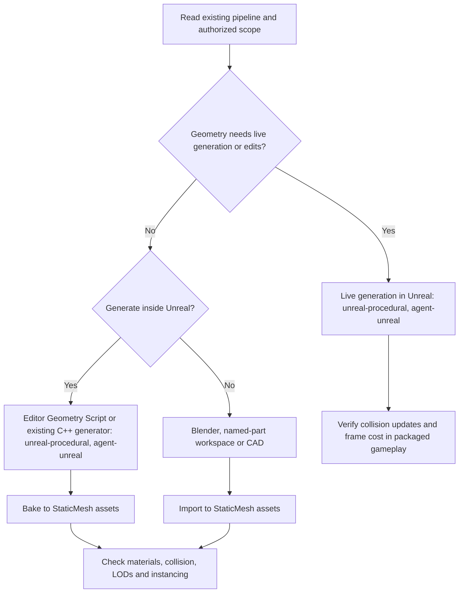

# Unreal mesh decision tree

This is decision guidance, not a benchmark result. Start with the existing project contract and the change the
user authorized. Authoring language, import automation and runtime mesh representation are separate decisions.

## Read the branches precisely

- **Static does not mean hand-authored.** Seeded layouts, track generators and construction-time C++ can produce
  fixed geometry that is baked in the editor. Preserve generator parameters and rebuild commands. Unreal editor
  Python can orchestrate generation, import and configuration; it is not shipped gameplay Python.
- **Include live vertex edits, not just topology changes.** A road dent can keep its indices while moving vertices
  and changing collision; that still needs a runtime update path. Moving a windmill wheel or using an existing
  skeletal/morph animation does not by itself require a procedural mesh. Preserve addressed nodes, pivots, bones
  and deformation contracts before merging/baking.
  This tree's StaticMesh branch is for static props; a character or skeletal asset retains its rig pipeline.
- **Runtime generation is decided inside Unreal.** Reuse a proven project route first. Otherwise the Geometry Script
  trial, the choice between ProceduralMeshComponent, DynamicMeshComponent, RealtimeMeshComponent and a runtime-built
  UStaticMesh, and the Nanite compatibility gate are covered by the Geometry Scripting, ProceduralMeshComponent and
  Nanite references of the `unreal-procedural` and `unreal-rendering` skills in agent-unreal.

## Trial acceptance

Before batching, record the project's material/vertex-color and coordinate contracts, target-load counts, and
collision/query policy. Prove one representative asset through the real project:

For the StaticMesh branch, [static-prop import checks](../../mesh-build/references/unreal-static-props.md)
provide bounds, triangle counts, Nanite/UV settings and an asymmetric signed-axis calibration in a scratch
project. Use those to diagnose import facts, then repeat the required checks in the consuming project.

1. Check saved/imported asset type, names, scale, pivot, material slots and effective vertex colors.
2. Inspect game-camera appearance and any addressed motion, LODs or repeated instances.
3. Test required collision traces and simulation in a packaged build. For live edits, measure collision-update
   delay, repeated/overlapping edits, reset/cleanup and load-dependent frame cost.
4. Report format, import, visual, gameplay and performance evidence separately. A validator or `verify-unreal`
   import receipt cannot establish all five.

The [tool profiles](tool-profiles.md) give concrete **Time, Risk, Complexity, Best practice and Maintainability**
implications for each route. The [evidence list](evidence.md) distinguishes official support, vendor claims and
single-author workarounds. Fill the [project contract card](existing-project-engagement.md) before the trial.
